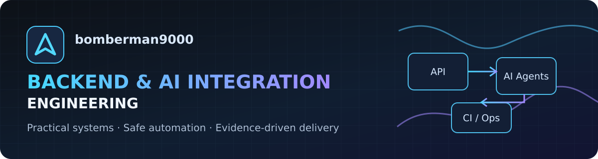

<h3 align="center">Backend Engineer · AI Integration · Automation · DevOps</h3>

  I build real business systems: logistics workflows, web applications, APIs and human-supervised AI automation.

  <a href="https://github.com/bomberman9000?tab=repositories">Explore repositories</a> ·
  <a href="https://github.com/bomberman9000/vialabote-shop">E-commerce code</a> ·
  <a href="https://github.com/bomberman9000/logistics-site">Logistics website</a>

---

### Featured engineering work

<table>
<tr>
<td width="50%" valign="top">

#### 🚚 GruzPotok V1 — logistics platform
**Private source · Product engineering**

Cargo and fleet workflows, carrier matching, deals, document generation, API services and release tooling.

`Python` · `FastAPI` · `PostgreSQL` · `Redis` · `React` · `Docker`

**Engineering focus:** data consistency, migrations, reproducible tests and controlled release. The code is private; architecture can be discussed selectively.

</td>
<td width="50%" valign="top">

#### 🤖 SoftZero / TILA — agent oversight
**Private source · AI systems engineering**

Supervised orchestration for AI coding agents with approval gates, action budgets, review evidence and operational safeguards.

`Python` · `Linux` · `Docker` · `CI/CD` · `LLM integrations`

**Engineering focus:** human control, observability and bounded automation. Source and internal security details are not public.

</td>
</tr>
<tr>
<td valign="top">

#### 🛍️ [ViALaBote — e-commerce](https://github.com/bomberman9000/vialabote-shop)
**Public source**

Next.js storefront with product catalogue, cart, checkout, account pages and administration.

`Next.js` · `TypeScript` · `Prisma` · `Tailwind`

[View portfolio case (draft)](https://github.com/bomberman9000/vialabote-shop/blob/docs/portfolio-readme-20261118/PORTFOLIO.md)

</td>
<td valign="top">

#### 🌐 [Logistics Website](https://github.com/bomberman9000/logistics-site)
**Public source**

Responsive logistics business website, service and route pages, inquiry form and Telegram integration.

`Next.js` · `React` · `TypeScript` · `Tailwind`

[View portfolio case (draft)](https://github.com/bomberman9000/logistics-site/blob/docs/portfolio-case-20261118/PORTFOLIO.md)

</td>
</tr>
</table>

### Tech stack

| Backend & data | Frontend | Infrastructure | AI & automation |
| :-- | :-- | :-- | :-- |
| Python · FastAPI · PostgreSQL · Redis | TypeScript · React · Next.js · Tailwind | Linux · Docker · GitHub Actions · CI/CD | LLM integrations · agent orchestration · controlled workflows |

### How I work

- **Build for real workflows:** connect interfaces, APIs, data and operations.
- **Verify claims:** distinguish passing tests from observed behavior in production.
- **Release safely:** use PR reviews, evidence, backups and authorization gates.
- **Protect data:** do not publish credentials, customer records or private infrastructure details.

### Open to opportunities

**Backend engineering · AI integrations · automation systems · DevOps-oriented product engineering**

Interested in remote engineering roles and practical product development.  
Explore [my repositories](https://github.com/bomberman9000?tab=repositories) and reach out through GitHub.

Portfolio descriptions document implemented or ongoing engineering scope; they do not claim that every workflow has passed live production acceptance.
