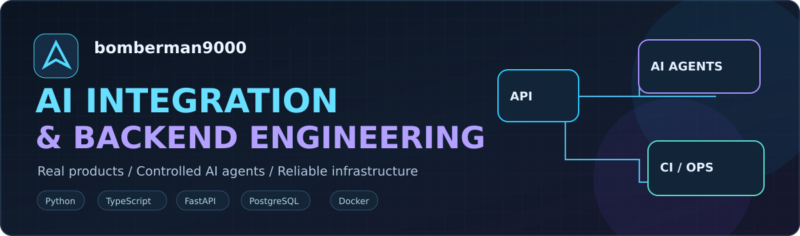
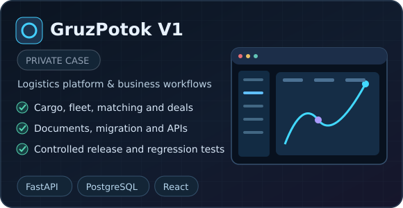
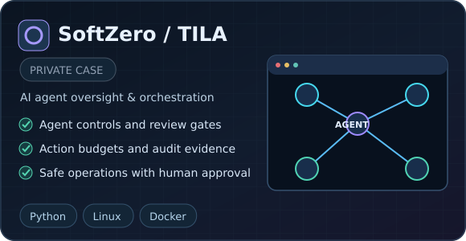
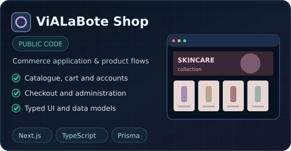
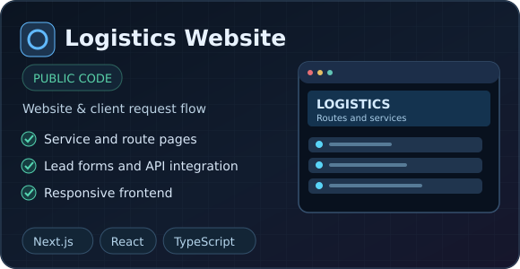

  

  <strong>Building reliable business systems, AI agents and full-stack products.</strong>

  <a href="https://github.com/bomberman9000?tab=repositories">Repositories</a> ·
  <a href="https://github.com/bomberman9000/vialabote-shop">E-commerce</a> ·
  <a href="https://github.com/bomberman9000/logistics-site">Logistics web</a>

### 📌 Featured Projects

<table>
<tr>
<td width="50%" valign="top">
  
  
<strong>GruzPotok V1</strong> · Private product

  
Logistics product covering cargo, fleet, matching, deal and document workflows. Engineering focus: transactional data, migration safety, testing and deployment control. Source is private.

</td>
<td width="50%" valign="top">
  
  
<strong>SoftZero / TILA</strong> · Private product

  
Oversight and coordination for AI coding agents, including review evidence, action budgets, safeguards and human approvals. Internal systems and security information remain private.

</td>
</tr>
<tr>
<td width="50%" valign="top">
  
  
<strong><a href="https://github.com/bomberman9000/vialabote-shop">ViALaBote Shop</a></strong> · Public source

  
Next.js / TypeScript catalogue, cart, checkout, account and administrative workflows. <a href="https://github.com/bomberman9000/vialabote-shop/blob/docs/portfolio-readme-20261118/PORTFOLIO.md">Case study draft</a>.

</td>
<td width="50%" valign="top">
  
  
<strong><a href="https://github.com/bomberman9000/logistics-site">Logistics Website</a></strong> · Public source

  
Next.js business site with service and route pages, a lead form and Telegram integration. <a href="https://github.com/bomberman9000/logistics-site/blob/docs/portfolio-case-20261118/PORTFOLIO.md">Case study draft</a>.

</td>
</tr>
</table>

### ⚙️ Tech Stack

  
  
  
  
  
  
  
  
  
  

<table>
<tr>
<td width="50%" valign="top">

### 🎯 What I Bring
- Real product and API development
- AI integration with human control
- Data consistency and reliability
- Test evidence and careful releases

</td>
<td width="50%" valign="top">

### 🚀 Open to Opportunities
- Backend Engineering
- AI Integration & Automation
- DevOps-oriented Product Engineering
- Remote roles and technical collaborations

</td>
</tr>
</table>

Project descriptions reflect implementation scope, not certification of live business behavior. Private code, credentials and customer data are not disclosed.
